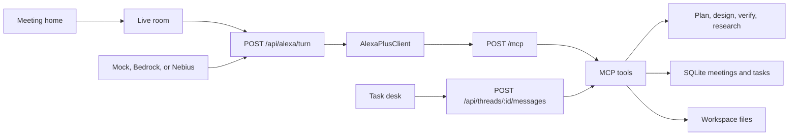

# Talk2Build

Talk2Build is a meeting room with an agent in it, built for the Alexa+ track of the Amazon Developer Hackathon (`amazonappdev2026`), plus the AWS Builder and Open Source mini challenges. People talk; Alexa+ (a self-hosted MCP server on spec `2025-11-25` over Streamable HTTP, driven by a simulated Alexa+ client in the web app) turns real decisions into plan, design, feasibility and evidence cards while the meeting goes on. Chatter is parked. Anything that writes code waits for a spoken yes. Ending the meeting writes minutes.

Demo video (2:26): https://youtu.be/oLMys1SccUk. It shows the **pizza game jam**: three people specify Space Cat Courier, a tiny canvas game, and after a "Yes" Talk2Build writes `docs/spec.md` from their decisions, scaffolds a playable prototype from its game-jam template, and runs `node --test` (7/7).

## For judges

About five minutes, no API keys, no account:

```bash
nvm use 22          # Node.js 22+ is required (node:sqlite)
npm install
npm test            # 160+ tests, including an HTTP end-to-end game-jam meeting and the MCP transport
npm run build
MCP_DEMO_TOKEN=$(openssl rand -hex 16) TALK2BUILD_SESSION_SECRET=$(openssl rand -hex 24) npm start
```

Open http://127.0.0.1:43123, click **Start meeting**, then **More → Play the pizza game jam (v2 demo)**. What to look for:

1. A Plan card under Maya's name; architecture and wireframe SVGs inline in their cards and on the shared stage.
2. "Phaser or PixiJS?" → an Evidence card with live GitHub and npm numbers and their source URLs (needs internet; set `TALK2BUILD_LIVE=0` for tests offline).
3. "Is the pizza here yet?" is parked, not planned.
4. The scaffold job waits for "Yes", then shows `node --test: 7/7 passing`. Click **▶ Play the prototype** or watch it on the shared stage.
5. **End** writes minutes.

To exercise the MCP server directly as an MCP client would (initialize → tools/list → tools/call):

```bash
TOKEN=...   # the MCP_DEMO_TOKEN you started with
curl -si http://127.0.0.1:43123/mcp -H "authorization: Bearer $TOKEN" -H 'content-type: application/json' \
  -H 'accept: application/json, text/event-stream' \
  -d '{"jsonrpc":"2.0","id":1,"method":"initialize","params":{"protocolVersion":"2025-11-25","capabilities":{},"clientInfo":{"name":"judge","version":"1"}}}'
# then send tools/list with the returned MCP-Session-Id and MCP-Protocol-Version: 2025-11-25 headers
```

Honest scope: by default the demo runs in mock mode. Meeting turns are planned deterministically and agent output comes from recorded fixtures, so no model is called. The game comes from a template written ahead of time; the meeting picks it and the spec is generated from the meeting. The evidence numbers and the test run are real. Bedrock is wired in (`src/lib/llm/bedrock.ts`) and runs when you supply AWS credentials; see **Live Amazon Bedrock** below.

## Live transcription (real speech)

The scripted game jam is the showcase, but the room also takes real speech. Both paths feed the same meeting-turn pipeline as typed lines, with the speaker taken from the **Speaking as** picker. Each transcript line is tagged with how it arrived (`mic · Whisper`, `mic · browser`).

| Mode | How | Key needed |
| --- | --- | --- |
| Server, local Whisper | `TALK2BUILD_STT=whisper`. The mic button records until you click it again, then posts the clip to `POST /api/meetings/:id/transcribe?speaker=Maya`. A local [faster-whisper](https://github.com/SYSTRAN/faster-whisper) worker (`scripts/whisper_worker.py`) transcribes it | none |
| Browser, Web Speech API | Used when server transcription is off. Live interim captions; each final phrase becomes a turn. Availability depends on the browser (Chrome sends audio to its own speech service) | none |
| Amazon Transcribe (streaming) | Reserved provider id `amazon-transcribe`. **Not implemented yet**; selecting it returns 501 with that message | AWS |

Set up local Whisper once:

```bash
python3 -m venv .venv-stt && .venv-stt/bin/pip install faster-whisper numpy   # ffmpeg must be on PATH
TALK2BUILD_STT=whisper TALK2BUILD_WHISPER_PYTHON=$PWD/.venv-stt/bin/python npm start
# optional: TALK2BUILD_WHISPER_MODEL=small.en (default base.en; the model downloads on first use)
```

Send a recorded clip without a browser:

```bash
curl -s -X POST "http://127.0.0.1:43123/api/meetings/$MEETING/transcribe?speaker=Maya&language=en" \
  -H 'content-type: audio/wav' --data-binary @line.wav
```

The response has the transcription (text, segments, latency) and the meeting turn it produced. `GET /api/stt` reports the active provider. Speaker attribution is manual for now (one speaker per clip, from the picker); diarization is future work.

## Production start

`npm run dev` is for development only. For demos, recordings and judging, use the production build:

| Variable | Required | Notes |
| --- | --- | --- |
| `MCP_DEMO_TOKEN` | yes | Random, at least 16 characters. Bearer token for `/mcp`. `talk2build-demo` is rejected |
| `TALK2BUILD_SESSION_SECRET` | yes | At least 32 characters. Signs meeting session cookies |
| `TALK2BUILD_HOME` | no | Data directory (SQLite + workspaces). Default `./data` |
| `LLM_PROVIDER`, `TALK2BUILD_AGENT` | no | `mock` forces the deterministic path even if AWS keys are set |
| `TALK2BUILD_JOB_PACE_MS` | no | Delay between card updates (the video used 650) |
| `MCP_ALLOWED_ORIGINS` | no | Extra comma-separated origins allowed to call `/mcp` |

`npm run build && npm start` serves on port 43123. `NODE_ENV=production` always requires the bearer token on `/mcp`.

## Live Amazon Bedrock

The planner and the in-room agent call Bedrock Converse through `@aws-sdk/client-bedrock-runtime` when credentials are present. Default model `amazon.nova-lite-v1:0` (`BEDROCK_MODEL_ID` overrides). To check one live call with your own account:

```bash
AWS_REGION=us-east-1 AWS_ACCESS_KEY_ID=... AWS_SECRET_ACCESS_KEY=... npm run bedrock:smoke
```

It prints the plan, model, region and latency, or exits 2 without calling anything when no credentials are set. To run whole meetings on Bedrock, start the server with the same AWS variables and `TALK2BUILD_AGENT=bedrock` (do not set `LLM_PROVIDER=mock`). Enable model access for Nova Lite in the Bedrock console first. A Bedrock failure falls back to the deterministic path and is marked degraded.

The UI follows a desktop meeting-client layout (study in `docs/design/`). The other scripted modes are below.

## Run it (development)

```bash
npm install
npm test
npm run dev
```

Open [http://127.0.0.1:43123](http://127.0.0.1:43123). No API keys. Talk2Build needs Node.js 22 or newer because meetings are stored with `node:sqlite`. `.nvmrc` is `22`. `npm test`, `npm run dev`, and `npm run build` check the version first and stop with that requirement on Node 20 instead of exiting from a missing module. `npm run dev` also sets `NODE_OPTIONS=--experimental-sqlite`.

On the meeting home:

- **Start meeting** opens a room with you, Maya, Chris, and Priya. **Play a working session** runs a billing-export conversation. The right panel fills in a plan, an architecture sketch, a settings wireframe, an API spec, a feasibility check, and a research card that cites yesterday's decision. Lunch is parked. Tests wait until someone says yes.
- **Join** takes a code. Your room is `TB-ROOM`. **Schedule** leaves a meeting on the list.
- **Incident demo** resets the 2:17 AM room. **Play the 2:17 script** runs the eight beats. `stop` and `不对` roll back one checkpoint.
- **Task desk** (`/tasks`) is the secondary thread view.

Meetings, tasks, messages, and artifacts are stored in `data/talk2build.sqlite`. Workspace files live under `data/workspaces/`. Both are gitignored.

## Architecture



Alexa+ is the voice front-end. `src/alexa/client.ts` is a Streamable HTTP client for MCP protocol `2025-11-25`. The web app calls it for every meeting utterance. A device uses the same server through `alexa/addon-package/addon.json` (`integrations[].type` is `MCP`).

The task desk streams a plan, each tool call, and the reply as server-sent events. The right-hand task monitor shows the to-do list, the files written for that task, and the MCP tools that ran.

| Tool | What it does |
| --- | --- |
| `ingest_transcript` / `classify_utterance` | Store a line and label it |
| `timeline_add` / `timeline_correlate` | Marks on the timeline, and the link between them |
| `chatter_park` | Side talk, kept out of the requirement pool |
| `decision_record` / `requirement_add` / `todo_add` | Decisions, the pool, action items |
| `confirm_ask` | Asks before a diff, a PR, a scaffold, a test run, or issues |
| `write_doc` | Markdown in the workspace. Docs do not wait |
| `plan_update` | Live plan card: goal and milestones |
| `design_draft` | Architecture diagram, UI wireframe, or API spec while design is discussed |
| `verify_check` | Feasibility against earlier decisions. The test suite still waits for a yes |
| `research_collect` | References from past meetings and saved preferences. Mock mode does not invent web citations |
| `suggest_surface` / `preference_note` | A timely reminder, and a preference the next meeting can use |
| `search_memory` | Decisions and action items across meetings, including yesterday |
| `create_issues` | One markdown issue per open action item |
| `meeting_summary` | Minutes back onto the task |
| `meeting_open` | A live room and a join code |
| `scaffold_code` / `pr_draft` / `run_tests` | Incident meetings use the Redis-pool fix. Other workspaces get real files and `node --test` |
| `deploy_lookup` / `diff_fetch` | Incident fixtures, or `git log` / `git diff` when the workspace is a repository |
| `list_workspace` / `read_file` / `write_file` | Workspace files. Paths cannot escape the folder |
| `report_progress` / `checkpoint_rollback` | Status line, and `stop` / `不对` |

Small writes happen immediately. Scaffolding, test runs, issue creation, and pull requests wait for a yes.

## Models

Meeting turns still classify through `LLM_PROVIDER` (mock unless you set one). The **in-room agent** is separate. It picks a backend in this order:

1. `TALK2BUILD_AGENT` if set (`bedrock`, `nebius`, `openai`, or `mock`)
2. Otherwise `LLM_PROVIDER` when that is set
3. Otherwise Bedrock when both `AWS_ACCESS_KEY_ID` and `AWS_SECRET_ACCESS_KEY` are set, or when `AWS_BEARER_TOKEN_BEDROCK` is set. One key alone is skipped, with a log line, and the agent falls through to Nebius, OpenAI, or the fixture model
4. Otherwise Nebius when `NEBIUS_API_KEY` is present, or any OpenAI-compatible server when `OPENAI_API_KEY` is present
5. Otherwise the recorded-fixture model. That path does not call the network

| Variable | Role |
| --- | --- |
| `AWS_REGION`, `AWS_ACCESS_KEY_ID`, `AWS_SECRET_ACCESS_KEY` | Bedrock key pair. Both the access key id and the secret are required |
| `BEDROCK_MODEL_ID` | Bedrock model. Default `amazon.nova-lite-v1:0` |
| `NEBIUS_API_KEY` | Nebius Token Factory. Default base URL `https://api.tokenfactory.nebius.com/v1` |
| `OPENAI_API_KEY`, `OPENAI_BASE_URL`, `OPENAI_MODEL` | Any OpenAI-compatible `/chat/completions` server, including a local stub |
| `TALK2BUILD_AGENT=mock` | Force the fixture model even if keys are set |
| `TALK2BUILD_JOB_PACE_MS` | Delay between card updates. Tests force this to 0 |

With no keys, plan, design, verify, and research still run as background jobs and write files under the meeting workspace.

If the room compares technologies ("which is more popular, Express or Fastify?"), an Evidence card fetches GitHub stars, open issues, latest release, and last push, plus npm weekly downloads or PyPI recent downloads, and the documentation URL listed by the registry. Every number keeps its source URL and fetch time. A failed call is shown as a failure. The model does not fill in missing numbers. Tech selection and requirement review are written only from those rows. The same jobs are drawn as a decision tree: the goal at the root, topics as branches, and alternatives side by side. After the evidence is in, Architect and Skeptic join the grid and can be called with `@architect` and `@skeptic`.

`TALK2BUILD_LIVE=0` skips the tests that call the public APIs. They run by default when the network is up.

A code job only scaffolds, writes `docs/patch.diff`, and drafts a pull request after someone says yes. Research sources are earlier decisions and saved preferences. URLs that were not already in the context are dropped.

The task composer can still pin Mock, Bedrock, or Nebius per thread. If Bedrock or the OpenAI-compatible endpoint fails, a meeting turn falls back to the deterministic classifier and the response is marked degraded.

See `.env.example`. `TALK2BUILD_HOME` moves the SQLite file and the workspaces.

## Alexa+

The hackathon asks for a self-hosted MCP server on spec `2025-11-25` or later, Streamable HTTP, and for the repo to call that technology rather than only mention it.

- The server is `/mcp`, implemented in `src/mcp/handler.ts`.
- Meeting utterances go through `AlexaPlusClient` over HTTP. `npm test` includes that round trip.
- `alexa/addon-package/addon.json` is the add-on manifest. `integrations[0].type` is `MCP`.

To put it on a device:

1. Serve the app on a public HTTPS URL. A tunnel such as cloudflared is enough for development. Alexa+ will not call localhost.
2. Replace every `https://example.com/...` value in `addon.json` with that origin. Icons and the carousel already exist at `/alexa/*.png`. Privacy and terms are `/privacy` and `/terms`.
3. Point `integrations[].config.endpoints.default.uri` at `https://YOUR_HOST/mcp`.
4. Install the [Alexa AI CLI](https://developer.amazon.com/docs/alexaplus/add-ons/mcp-toolkit-quickstart.html), run `alexa-ai configure`, then `alexa-ai deploy` from this repo once the manifest paths match what the CLI expects (`addon-package/addon.json`).
5. Auth is off for local development. Set `MCP_REQUIRE_AUTH=true` to require a bearer token. Unauthenticated `/mcp` calls then return `401` with no `WWW-Authenticate` header. Protected-resource and authorization-server metadata are under `/.well-known/`, and the token endpoint speaks OAuth 2.1 authorization-code + PKCE `S256`. The local authorization server auto-approves. Do not use it as a production identity provider.
6. `NODE_ENV=production` always requires auth, even when `MCP_REQUIRE_AUTH` is unset. Set `MCP_DEMO_TOKEN` to a random secret of at least 16 characters. The public value `talk2build-demo` is rejected. The same bearer token is required on `POST /api/meetings/:id/jobs/:jobId/cancel`. The in-room cancel button does not send that token; it cancels through a server action. Send `Authorization: Bearer $MCP_DEMO_TOKEN` for the HTTP cancel route and for `/mcp`.

`npm run mcp` serves the same routes headless, bound to `127.0.0.1` unless you set `HOST`.

Round-trip tool calls in mock mode are well under the 500 ms Alexa+ budget. A live Bedrock plan is extra latency on top of the tool call.

## Tests

```bash
npm test
```

- Classifier and incident fixtures, including the 50 → 20 diff and the missing timeout.
- A generic “root cause” on a normal meeting does not open the Redis pull request. The scripted 2:17 AM lines still do.
- MCP transport: session, protocol header, SSE, origin rejection, and the PKCE login.
- Provider adapters for Bedrock and the OpenAI-compatible API, with injected responses.
- SQLite reload, a real `node --test` in a workspace, and path escape rejection.
- Chat: yesterday's decision, then issues on disk after a yes.
- A meeting that ends posts minutes onto its task, including the completion report.
- Agent jobs: recorded fixtures, concurrent runs, cancel, the yes gate, and a local OpenAI-compatible stub.
- The scripted postmortem through the Alexa+ client, plus rollback on `stop` and `不对`.

## Docs for the submission

- [Devpost description](docs/devpost-description.md)
- [Product feedback](docs/product-feedback.md)
- [Friction log](docs/friction-log.md)
- [Shot list](docs/shot-list.md) for the video, at or under three minutes

## License

MIT. See [LICENSE](LICENSE).
