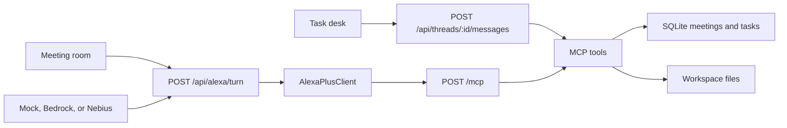

# Talk2Build

Describe the result. Talk2Build plans the steps, runs the tools, and leaves the files in the workspace. A meeting is one of those tasks: Alexa+ listens, chatter stays out of the requirement pool, and the minutes land back on the task when the room ends.

The 2:17 AM orders postmortem is one mode, opened from **Incident demo**. It is not the home page.

This is an Alexa+ track project for the Amazon Developer Hackathon (`amazonappdev2026`), with the AWS Builder and Open Source mini challenges in mind.

## Run it

```bash
npm install
npm test
npm run dev
```

Open [http://127.0.0.1:43123](http://127.0.0.1:43123). No API keys. The dev server needs Node's SQLite flag; `npm run dev` sets `NODE_OPTIONS=--experimental-sqlite`.

On the desk:

- **New task** starts a thread. The empty state asks for an outcome, not a meeting console.
- Try “What did we decide yesterday?”, then “Turn yesterday's action items into issues” and confirm with yes. The first launch seeds yesterday's API review so that question has an answer.
- **Start a planning meeting** opens a room: participant tiles, mic, live captions, and the requirement pool. **End meeting** writes minutes and posts them on the linked task.
- **Incident demo** resets the 2:17 AM room. **Play the 2:17 script** runs the eight beats. `stop` and `不对` roll back one checkpoint.

Meetings, tasks, messages, and artifacts are stored in `data/talk2build.sqlite`. Workspace files live under `data/workspaces/`. Both are gitignored.

## Architecture



Alexa+ is the voice front-end. `src/alexa/client.ts` is a Streamable HTTP client for MCP protocol `2025-11-25`. The web app calls it for every meeting utterance. A device uses the same server through `alexa/addon-package/addon.json` (`integrations[].type` is `MCP`).

The task desk streams a plan, each tool call, and the reply as server-sent events. The right-hand task monitor shows the to-do list, the files written for that task, and the MCP tools that ran.

| Tool | What it does |
| --- | --- |
| `ingest_transcript` / `classify_utterance` | Store a line and label it |
| `timeline_add` / `timeline_correlate` | Marks on the timeline, and the link between them |
| `chatter_park` | Side talk, kept out of the requirement pool |
| `decision_record` / `requirement_add` / `todo_add` | Decisions, the pool, action items |
| `confirm_ask` | Asks before a diff, a PR, a scaffold, a test run, or issues |
| `write_doc` | Markdown in the workspace. Docs do not wait |
| `search_memory` | Decisions and action items across meetings, including yesterday |
| `create_issues` | One markdown issue per open action item |
| `meeting_summary` | Minutes back onto the task |
| `meeting_open` | A live room and a join code |
| `scaffold_code` / `pr_draft` / `run_tests` | Incident meetings use the Redis-pool fix. Other workspaces get real files and `node --test` |
| `deploy_lookup` / `diff_fetch` | Incident fixtures, or `git log` / `git diff` when the workspace is a repository |
| `list_workspace` / `read_file` / `write_file` | Workspace files. Paths cannot escape the folder |
| `report_progress` / `checkpoint_rollback` | Status line, and `stop` / `不对` |

Small writes happen immediately. Scaffolding, test runs, issue creation, and pull requests wait for a yes.

## Models

`LLM_PROVIDER` picks who plans a meeting turn. The task composer can pin Mock, Bedrock, or Nebius per thread. If Bedrock or the OpenAI-compatible endpoint fails, the turn falls back to the deterministic classifier and the response is marked degraded. Task tool routing stays deterministic so the desk works with no keys.

| Value | Where it runs |
| --- | --- |
| `mock` (default) | Local rules. No network, no key |
| `bedrock` | Amazon Bedrock Converse (`@aws-sdk/client-bedrock-runtime`) |
| `openai` | Any OpenAI-compatible `/chat/completions` |
| `nebius` | Same adapter, defaulting to `https://api.tokenfactory.nebius.com/v1` and `nvidia/Nemotron-3_5-Lightning` |

See `.env.example`. `TALK2BUILD_HOME` moves the SQLite file and the workspaces.

## Alexa+

The hackathon asks for a self-hosted MCP server on spec `2025-11-25` or later, Streamable HTTP, and for the repo to call that technology rather than only mention it.

- The server is `/mcp`, implemented in `src/mcp/handler.ts`.
- Meeting utterances go through `AlexaPlusClient` over HTTP. `npm test` includes that round trip.
- `alexa/addon-package/addon.json` is the add-on manifest. `integrations[0].type` is `MCP`.

To put it on a device:

1. Serve the app on a public HTTPS URL. A tunnel such as cloudflared is enough for development. Alexa+ will not call localhost.
2. Replace every `https://example.com/...` value in `addon.json` with that origin. Icons and the carousel already exist at `/alexa/*.png`. Privacy and terms are `/privacy` and `/terms`.
3. Point `integrations[].config.endpoints.default.uri` at `https://YOUR_HOST/mcp`.
4. Install the [Alexa AI CLI](https://developer.amazon.com/docs/alexaplus/add-ons/mcp-toolkit-quickstart.html), run `alexa-ai configure`, then `alexa-ai deploy` from this repo once the manifest paths match what the CLI expects (`addon-package/addon.json`).
5. Optional: `MCP_REQUIRE_AUTH=true`. Unauthenticated `/mcp` calls return `401` with no `WWW-Authenticate` header. Protected-resource and authorization-server metadata are under `/.well-known/`, and the token endpoint speaks OAuth 2.1 authorization-code + PKCE `S256`. The local authorization server auto-approves. Do not use it as a production identity provider.

`npm run mcp` serves the same routes headless, bound to `127.0.0.1` unless you set `HOST`.

Round-trip tool calls in mock mode are well under the 500 ms Alexa+ budget. A live Bedrock plan is extra latency on top of the tool call.

## Tests

```bash
npm test
```

- Classifier and incident fixtures, including the 50 → 20 diff and the missing timeout.
- A generic “root cause” on a normal meeting does not open the Redis pull request. The scripted 2:17 AM lines still do.
- MCP transport: session, protocol header, SSE, origin rejection, and the PKCE login.
- Provider adapters for Bedrock and the OpenAI-compatible API, with injected responses.
- SQLite reload, a real `node --test` in a workspace, and path escape rejection.
- Chat: yesterday's decision, then issues on disk after a yes.
- A meeting that ends posts minutes onto its task.
- The scripted postmortem through the Alexa+ client, plus rollback on `stop` and `不对`.

## Docs for the submission

- [Devpost description](docs/devpost-description.md)
- [Product feedback](docs/product-feedback.md)
- [Friction log](docs/friction-log.md)
- [Shot list](docs/shot-list.md) for the video, at or under three minutes

## License

MIT. See [LICENSE](LICENSE).
