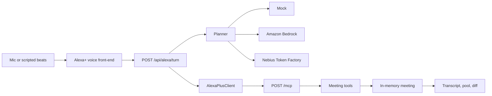

# Talk2Build

The meeting where the work gets done. Alexa+ listens to a working session, classifies every utterance, and the doc, the diff, and the pull request are ready when the room is.

This is an Alexa+ track project for the Amazon Developer Hackathon (`amazonappdev2026`), with the AWS Builder and Open Source mini challenges in mind. The demo is a postmortem of a 2:17 AM orders outage.

## Run the demo

```bash
npm install
npm test
npm run dev
```

Open [http://127.0.0.1:43123](http://127.0.0.1:43123) and press **Play demo**. No API keys. The scripted room replays the eight beats, speaks Alexa+ replies when the browser has a voice, and fills the three columns.

You can also pick speaker A or B, use the microphone (Web Speech API), or type a line. `stop` and `不对` roll the room back to the last checkpoint and ask what you want instead.

## What the demo shows

Two engineers walk the 2:17 AM incident:

1. Orders API 500s hit 40% at 2:17. The timeline records it.
2. Redis connections started climbing at 2:15. The marks are linked.
3. Alexa+ finds `batch-reconcile` v2.3, deployed at 11:40 PM, and asks before pulling the diff.
4. The diff highlights `max_connections` 50 → 20 and the removed command timeout.
5. The root cause is logged. The postmortem is written. The pull request waits for a yes.
6. Lunch talk is parked in the chatter column. Alexa+ stays quiet.
7. Two action items land: a pool alert, and a feature flag.
8. “Open the PR” scaffolds three files, drafts the PR, and the tests go green.

Progress lines are spoken on the way through.

## Architecture



Alexa+ is the voice front-end. In this repo that is `src/alexa/client.ts`: a Streamable HTTP client for MCP protocol `2025-11-25`. It initializes a session, sends `notifications/initialized`, and calls tools. The web app drives that client. A real Alexa+ device uses the same MCP server through the add-on in `alexa/addon-package/addon.json` (`integrations[].type` is `MCP`).

The MCP endpoint is `POST/GET/DELETE /mcp`. It checks `Origin`, speaks JSON or server-sent events, and issues an `MCP-Session-Id`. Tool calls mutate one in-memory meeting. Nothing is written to a database.

| Tool | What it does |
| --- | --- |
| `ingest_transcript` | Stores a line, with the speaker |
| `classify_utterance` | event, decision, requirement, todo, chatter, confirm, interrupt |
| `timeline_add` / `timeline_correlate` | Incident marks and the link between them |
| `chatter_park` | Side talk, kept out of the requirement pool |
| `deploy_lookup` | Finds batch-reconcile v2.3 at 11:40 PM |
| `diff_fetch` | The pool shrink and the missing timeout |
| `decision_record` | The decision, plus the requirements that fall out of it |
| `confirm_ask` | Asks before a large action |
| `todo_add` / `requirement_add` | Action items and the requirement pool |
| `write_doc` | Postmortem or a decision note. Docs do not wait |
| `scaffold_code` / `pr_draft` | Three-file fix and a draft pull request |
| `run_tests` | Checks the scaffold and attaches pass/fail |
| `report_progress` | The periodic spoken status line |
| `checkpoint_rollback` | `stop` / `不对` |

Small things (a doc) happen immediately. Large things (opening the PR, pulling the diff) wait for a yes.

## Models

`LLM_PROVIDER` picks who plans the turn. If Bedrock or the OpenAI-compatible endpoint fails, the turn falls back to the deterministic mock and the response is marked degraded. The demo script does not need that fallback: mock mode is deterministic.

| Value | Where it runs |
| --- | --- |
| `mock` (default) | Local rules. No network, no key |
| `bedrock` | Amazon Bedrock Converse (`@aws-sdk/client-bedrock-runtime`) |
| `openai` | Any OpenAI-compatible `/chat/completions` |
| `nebius` | Same adapter, defaulting to `https://api.tokenfactory.nebius.com/v1` and `nvidia/Nemotron-3_5-Lightning` |

See `.env.example`.

## Alexa+

The hackathon asks for a self-hosted MCP server on spec `2025-11-25` or later, Streamable HTTP, and for the repo to call that technology rather than only mention it. This repo does both:

- The server is `/mcp`, implemented in `src/mcp/handler.ts`.
- The Alexa+ client calls it over HTTP. `npm test` includes that round trip.
- `alexa/addon-package/addon.json` is the add-on manifest `alexa-ai new mcp` produces. `integrations[0].type` is `MCP`.

To put it on a device:

1. Serve the app on a public HTTPS URL. A tunnel such as cloudflared is enough for development. Alexa+ will not call localhost.
2. Replace every `https://example.com/...` value in `addon.json` with that origin. Icons and the carousel already exist at `/alexa/*.png`. Privacy and terms are `/privacy` and `/terms`.
3. Point `integrations[].config.endpoints.default.uri` at `https://YOUR_HOST/mcp`.
4. Install the [Alexa AI CLI](https://developer.amazon.com/docs/alexaplus/add-ons/mcp-toolkit-quickstart.html), run `alexa-ai configure`, then `alexa-ai deploy` from this repo once the manifest paths match what the CLI expects (`addon-package/addon.json`).
5. Optional: `MCP_REQUIRE_AUTH=true`. Unauthenticated `/mcp` calls return `401` with no `WWW-Authenticate` header, which is what the Alexa+ checklist asks for. Protected-resource and authorization-server metadata are under `/.well-known/`, and the token endpoint speaks OAuth 2.1 authorization-code + PKCE `S256`. The local authorization server auto-approves. Do not use it as a production identity provider.

`npm run mcp` serves the same routes headless, bound to `127.0.0.1` unless you set `HOST`.

Round-trip tool calls in mock mode are well under the 500 ms Alexa+ budget. A live Bedrock plan is extra latency on top of the tool call. Keep the model fast (Nova Lite, or a short Nemotron) if you turn a real provider on for the device path.

## Tests

```bash
npm test
```

- Classifier and tool fixtures, including the 50 → 20 diff and the missing timeout.
- MCP transport: session, protocol header, SSE, origin rejection, and the PKCE login.
- Provider adapters for Bedrock and the OpenAI-compatible API, with injected responses.
- An end-to-end run of the demo script through the Alexa+ client and the HTTP server. It asserts the timeline, the correlation, the decision, the todos, the parked chatter, the three-file PR, and green tests. A second case rolls back on `stop` and `不对`.

## Docs for the submission

- [Devpost description](docs/devpost-description.md)
- [Product feedback](docs/product-feedback.md)
- [Friction log](docs/friction-log.md)
- [Shot list](docs/shot-list.md) for the video, at or under three minutes

## License

MIT. See [LICENSE](LICENSE).
